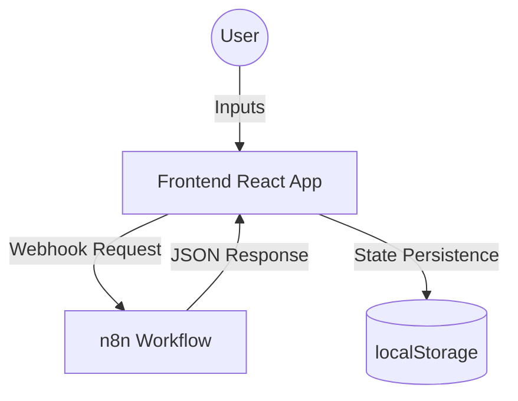
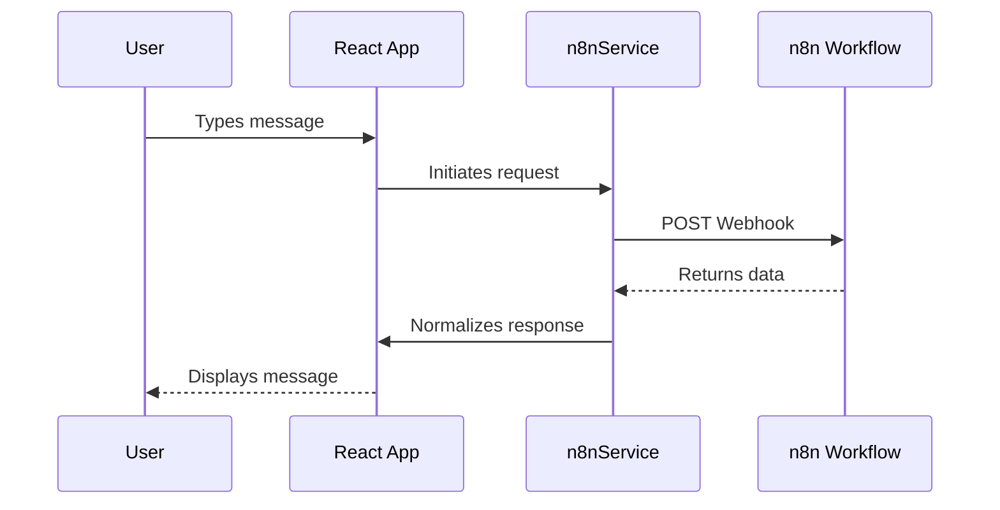

# My-Agent-app

A feature-rich chat-based agent application built with React, Vite, and Tailwind CSS. This application is designed to interface with n8n workflows, providing a modern and responsive chat experience.

## Features

- **Dynamic Chat Interface**: Real-time conversation management with Markdown support.
- **n8n Integration**: Seamless communication with configured n8n webhooks.
- **Theming**: Dark and light mode support using custom hooks.
- **Sidebar Navigation**: Easily manage multiple chat conversations.
- **Responsive Design**: Mobile-friendly layout.

## Technologies Used

- **Frontend**: React 19, Vite
- **Styling**: Tailwind CSS
- **Icons**: Lucide React
- **Utilities**: React Markdown, Remark GFM, Axios

## Architecture

`my-agent-app` is a single-page React application that serves as a frontend interface for custom AI agents built using n8n workflows.

### High-Level Architecture

### Data Flow

- **Frontend**: Built with React and Vite, utilizing Tailwind CSS for styling and custom hooks for state management.
- **Integration**: Communicates with external n8n workflows via HTTPS webhooks. A dedicated service layer (`n8nService.js`) normalizes AI responses, ensuring support for varied data structures returned by n8n.
- **State Management**: Uses custom hooks to manage conversation history, UI preferences (themes, sidebar state), and asynchronous chat flows, with persistent data storage via `localStorage`.

## Packages Used

Below are the main runtime and development dependencies pulled in via **package.json**:

### Runtime Dependencies
- `react` – UI library (v19.x)
- `react-dom` – DOM rendering for React
- `axios` – HTTP client for communicating with the n8n webhook
- `lucide-react` – Icon set used throughout the UI
- `react-markdown` – Render markdown content (used by Docs view)
- `remark-gfm` – GitHub‑flavored markdown support
- `tailwindcss` – Utility‑first CSS framework
- `@tailwindcss/vite` – Vite plugin for Tailwind integration

### Development Dependencies
- `vite` – Build tool and dev server
- `@vitejs/plugin-react` – Vite plugin for React fast refresh
- `eslint` – Linting
- `@eslint/js`, `eslint-plugin-react-hooks`, `eslint-plugin-react-refresh` – ESLint ecosystem for React
- `@types/react`, `@types/react-dom` – TypeScript type definitions (even though the project uses plain JS/JSX, they aid IDE support)
- `globals` – Provides global variable definitions for linting

## Project Summary & Contributions

The following key features and components have been implemented in this project:

* **Header Docs Button** – Added a `BookOpen` icon button that opens a slide‑over Docs view.
* **DocsView Component** – New component that fetches `README.md`, renders it with the existing `MarkdownRenderer`, and displays Mermaid diagrams.
* **Docs Side Panel** – Integrated DocsView into the main app with state handling (`showDocs`).
* **Architecture Documentation** – Added Mermaid diagrams for high‑level architecture and data flow.
* **Responsive UI** – Utilized Tailwind CSS and Lucide icons for a clean, responsive interface with dark mode support.
* **Webhook Status Indicator** – Visual status pill in the header to indicate n8n connection health.
* **Setup Instructions** – Simple steps to clone, install, and run the dev server.

These elements together provide a polished, documented, and easily navigable developer experience.

## Setup

1. **Clone the repository.**
2. **Install dependencies**: `npm install`
3. **Run the development server**: `npm run dev`

